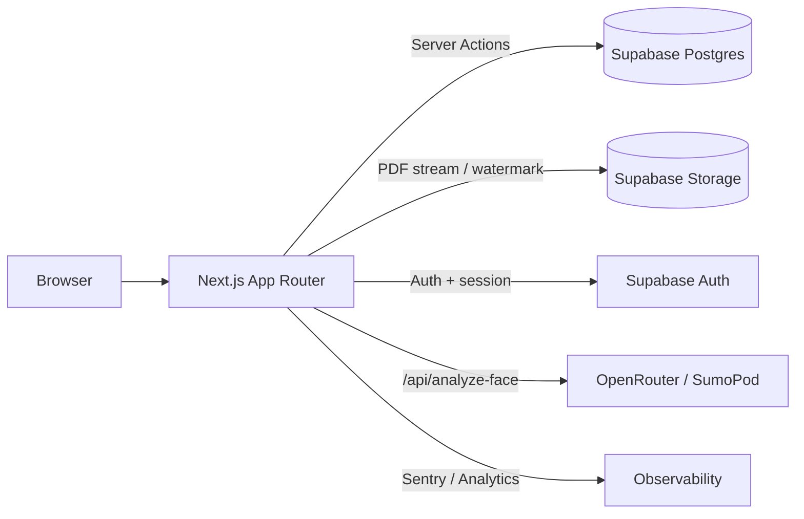

# Chikology

Chikology is an AI-assisted stress-tracking and digital e-book web application built for an Indonesian audience. Users capture a short selfie, answer an optional pre-scan questionnaire, and receive a stress level on a 1–5 scale along with Indonesian-language indicators, risks, and suggested interventions. Results and moods can be saved to a private journal, and users can read a sequentially released e-book whose chapters are unlocked individually through a manual purchase-verification flow.

Built and maintained by Dapur Solusi for the Chikology brand.

## Project Overview

Mental-health self-checking tools often require an account, a diagnosis, or a long survey before returning anything useful. Chikology lowers that first step to a single photo plus a few optional questions, then gives the user a concrete next action (a journal entry, a habit, or a consultation with the practitioner).

The application serves two audiences:

- **End users:** individuals tracking their stress over time and reading the paid e-book.
- **Administrators:** The practitioner responsible for publishing chapters, uploading PDFs, verifying payment proofs, and managing e-book availability.

## Responsible Use

Chikology's AI-generated stress indicators are intended for general wellness
and personal self-reflection only. They are not a medical assessment or
diagnosis and must not be used as a substitute for professional healthcare
advice. AI-generated results may be inaccurate and should not be used as
the sole basis for medical or mental-health decisions.

## Key Features

- **AI stress analysis:** Webcam capture via `react-webcam`; the face is cropped and sent to a server route that calls a vision model and returns a stress tier. A pre-scan questionnaire (multi-select, optional, skippable) adds context to the prompt. Tier, cues, and confidence are persisted; the UI adds static Indonesian guidance per tier.
- **Rate limiting:** 5 scans per user per day enforced in the database (`scan_usage`, unique per user and date) plus a short-window, process-local in-memory burst guard. The daily quota is database-backed; the burst guard is instance-local and is not a globally coordinated limit across serverless instances.
- **Personal journal:** Tiptap rich-text entries with a five-level mood selector, optional stress tier and recommendation. Entries are user-scoped; scan results can be saved into the journal with a pre-filled mood.
- **Digital e-book reader:** Chapter list with four access states (unreleased, locked, buyable, owned), and a reader page that renders the PDF in a self-hosted PDF.js viewer through a range-aware streaming endpoint.
- **Sequential chapter gating:** Chapter _N_ can only be purchased once chapter _N−1_ is owned. Free chapters are "claimed" into the same purchase table so ownership checks stay uniform.
- **Manual payment verification:** Users upload a payment proof; the attempt lands as `pending`; an admin approves or rejects it with a reason. Approval inserts the `chapter_purchases` row that unlocks the chapter.
- **Watermarked downloads:** Download responses are re-signed with `pdf-lib`, stamping a masked email and WIB timestamp on every page.
- **Scheduled release + feature flag:** Chapters carry an optional `release_date`; `app_settings.ebook_live` gates the marketing surface and purchase flow, flipped by a `pg_cron` job or manually from the admin page.
- **Admin console:** Chapter CRUD with PDF upload (max 50 MB), e-book live toggle, and a payment-verification queue. Access requires `users.role = 'admin'`.
- **Observability:** Sentry (client, server, edge) and Vercel Analytics; `/api/health` reports database connectivity.

## Technology Stack

| Layer                    | Technologies                                                                                                                     |
| ------------------------ | -------------------------------------------------------------------------------------------------------------------------------- |
| Frontend                 | Next.js 16 (App Router), React 19, TypeScript, Tailwind CSS v4, shadcn/ui, Radix UI, lucide-react, Tiptap, react-hook-form + Zod |
| Backend                  | Next.js Server Actions (mutations), Route Handlers (third-party proxies, PDF streaming), React Compiler                          |
| Database                 | Supabase Postgres, Drizzle ORM + `postgres` driver, drizzle-kit migrations, RLS policies                                         |
| Authentication           | Supabase Auth (Google OAuth), `@supabase/ssr` cookie sessions                                                                    |
| AI integration           | OpenRouter (`minimax/minimax-m3`) as primary vision model, SumoPod as fallback, OpenAI-compatible SDK                            |
| Storage & infrastructure | Supabase Storage (private PDF + payment-proof buckets), Vercel, Sentry, GitHub Actions CI                                        |
| Testing & tooling        | Vitest, Testing Library, jsdom, ESLint, Prettier, Husky, lint-staged, commitlint, bun                                            |

## Architecture Overview



- `src/app/(main)/` — public landing page, e-book promo, privacy policy.
- `src/app/dashboard/` — authenticated shell: stats, scanner, journal, book reader, admin pages.
- `src/actions/` — server actions for journal, chapters, payments, questionnaire, settings, admin.
- `src/app/api/` — `analyze-face` (AI proxy + rate limiting), `chapters/[id]/view` (PDF streaming with `Range` support), `chapters/[id]/download` (watermarked PDF), `health`.
- `src/lib/` — Supabase clients, chapter access rules, feature flags, rate limiter, scanner prompt builder.
- `src/db/` — Drizzle schema (10 tables) and client; migrations and RLS scripts in `drizzle/`.
- `src/proxy.ts` — Next.js 16 proxy (formerly middleware) refreshing the Supabase session and guarding `/dashboard/*`.

## Important Technical Implementations

**Session and authorization.** Supabase sessions live in cookies and are refreshed on every request in `src/proxy.ts`; unauthenticated `/dashboard/*` requests redirect to the landing page login. The dashboard layout performs a second server-side check. Every server action and API route re-derives the user from `getUser()` rather than trusting client input, and admin actions additionally assert `role === 'admin'`.

**Chapter access as a single decision point.** `canUserReadChapter()` in `src/lib/chapters.ts` returns a discriminated result (`owned`, `free-claimable`, or a denial reason). It is used by the reader page, both PDF routes, and the "next chapter" navigation, so ownership, sequential gating, and release-date logic cannot diverge between surfaces.

**Protected PDF delivery.** Files live in a private Supabase Storage bucket and are never exposed directly. The view route authenticates, checks access, then downloads with the service-role client and streams the bytes with `Range`/`206` handling so PDF.js can page through large files. Denials and views are appended to `chapter_access_logs`. A separate server action can issue four-hour signed URLs for authorized chapter access. It authenticates the current user and applies the same chapter-access policy before generating a URL. The reader itself uses the streaming route, which re-authorizes every request.

**AI integration resilience.** The scan route tries the primary provider twice, falls back to a secondary provider, tolerates both JSON and loosely wrapped responses (regex extraction of `tier`), clamps the result to 1–5, and returns 502 rather than a fabricated tier. API keys stay server-side; the client only sees `/api/analyze-face`.

**Data integrity.** `chapter_purchases` is unique per `(user, chapter)` and treated as immutable; `scan_usage` is unique per `(user, date)` and incremented with an atomic upsert. RLS policies enforce per-user row visibility for journals, purchases, and proofs, plus public read/admin write on chapters and settings.

## Data Handling & Privacy

- **Selfie processing:** The browser captures a selfie, crops the face, and submits the image to `/api/analyze-face`. The server forwards the image to the configured AI vision provider for analysis.
- **Selfie retention:** The application does not persist submitted selfie images in its database or Supabase Storage. Images are processed through the server-side analysis request.
- **Questionnaire responses:** Optional pre-scan questionnaire answers are included as additional context in the AI analysis request and persisted to the database.
- **Scan results:** The application persists the generated stress tier, analysis cues, and confidence information. Daily scan usage is tracked separately through `scan_usage`.
- **Personal journal:** Journal entries, mood selections, and associated stress information are stored per user. Row Level Security (RLS) restricts access to the respective user's records.
- **External AI processing:** Selfie images are processed by the configured external AI provider. Provider-side processing and data retention are subject to the respective provider's policies.

## Getting Started

**Prerequisites:** [bun](https://bun.sh), a Supabase project (Postgres + Storage + Google OAuth configured), and an OpenRouter key.

1. Install dependencies:

   ```bash
   bun install
   ```

2. Configure environment variables (see below) in `.env.local`.

3. Run migrations and apply RLS policies/buckets:

   ```bash
   bun run db:setup
   ```

4. Start the development server:

   ```bash
   bun run dev
   ```

   Open [http://localhost:3000](http://localhost:3000).

To promote a user to admin, set `users.role = 'admin'` for that row in Supabase.

## Environment Variables

| Name                            | Purpose                                                               |
| ------------------------------- | --------------------------------------------------------------------- |
| `DATABASE_URL`                  | Postgres connection string used by Drizzle ORM and drizzle-kit        |
| `NEXT_PUBLIC_SUPABASE_URL`      | Supabase project URL (server and browser clients)                     |
| `NEXT_PUBLIC_SUPABASE_ANON_KEY` | Supabase anonymous key for the browser/server session clients         |
| `SUPABASE_SERVICE_ROLE_KEY`     | Server-only key for storage downloads and privileged admin operations |
| `OPENROUTER_API_KEY`            | Primary vision model provider for `/api/analyze-face`                 |
| `CHIKOLOGY_SUMOPOD_API_KEY`     | Fallback AI provider key                                              |
| `OPENAI_BASE_URL`               | Base URL of the fallback provider (OpenAI-compatible)                 |
| `NEXT_PUBLIC_SENTRY_DSN`        | Sentry DSN for client and server error reporting                      |
| `SENTRY_DSN`                    | Optional server-side Sentry DSN override                              |

## Available Scripts

| Script                | Description                                  |
| --------------------- | -------------------------------------------- |
| `bun run dev`         | Start the Next.js development server         |
| `bun run build`       | Production build                             |
| `bun run start`       | Serve the production build                   |
| `bun run lint`        | Run ESLint                                   |
| `bun run test`        | Run Vitest (`--run` for a single pass)       |
| `bun run db:generate` | Generate a Drizzle migration from the schema |
| `bun run db:migrate`  | Apply pending migrations                     |
| `bun run db:rls`      | Apply RLS policies and storage bucket setup  |
| `bun run db:setup`    | Migrate + apply RLS in one step              |

`:prod` variants of the database scripts load `.env.production` and exist for deliberate production runs; do not use them against a shared database without explicit authorization.

## Testing

Tests use Vitest with jsdom and Testing Library, colocated as `*.test.ts(x)` files (45 test files covering route handlers, server actions, and UI components).

```bash
bun run test          # watch mode
bun run test --run    # single run
```

CI (`.github/workflows/ci.yaml`) runs Prettier check, ESLint, `tsc --noEmit`, tests, and a production build on pull requests and pushes to `main`/`development`.

## Project Information

- Live application: [www.chikology.id](https://www.chikology.id)
- Health check: [chikology.id/api/health](https://chikology.id/api/health)
- Repository: [dapursolusi/chikology-web-app](https://github.com/dapursolusi/chikology-web-app)
- Maintained by Dapur Solusi
